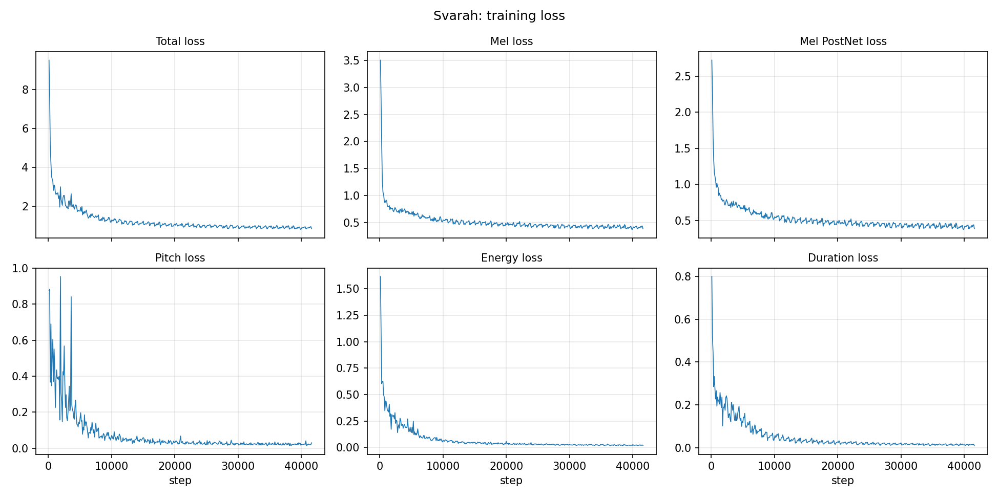
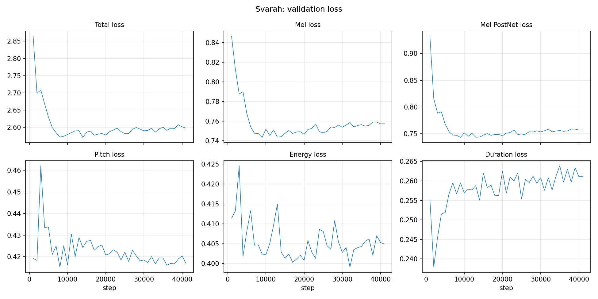
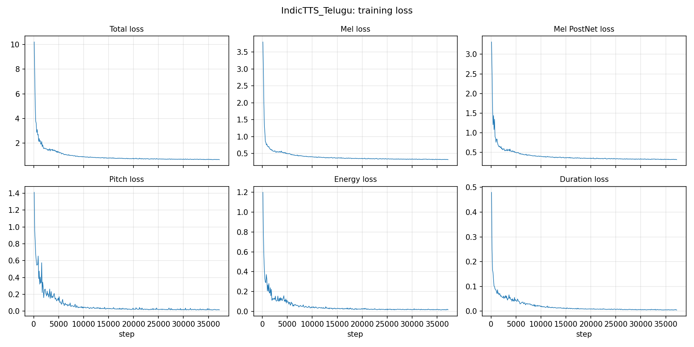
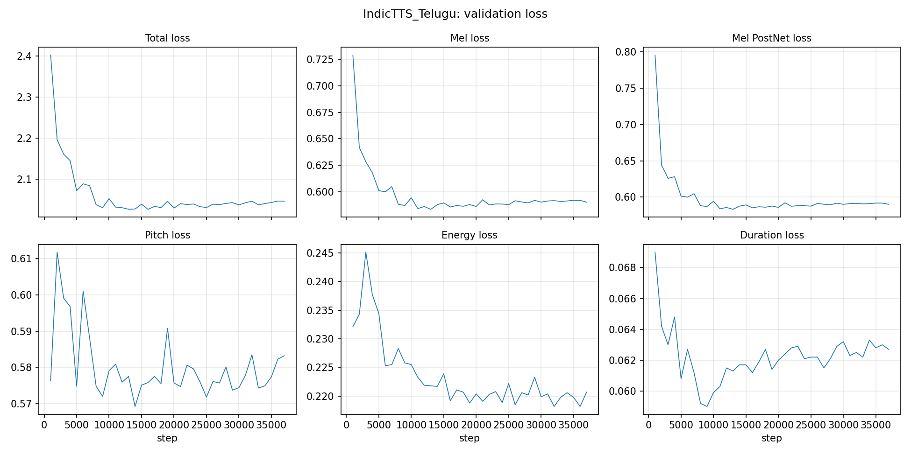

# 1. Summary

Two FastSpeech 2 models were trained **from scratch**, one per language, on about 5 h of training audio and 1 h of validation audio each. The code started from the public implementation `ming024/FastSpeech2`, which has been forked and modified.

| | English | Telugu |
|---|---|---|
| Dataset | Svarah (Indian-accented English) | IndicTTS Telugu |
| Speakers | 115 (multi-speaker model) | 1 male speaker (single-speaker model) |
| Train / val audio | 4.855 h / 1.023 h (3,539 / 706 clips) | 5.00 h / 1.00 h (2,626 / 525 clips) |
| Text → phonemes | CMUdict dictionary; MFA G2P for unknown words; part-of-speech rules for homographs | rule-based Telugu G2P (46 phones) |
| Alignment | MFA 3, pretrained `english_us_arpa` | MFA 3, acoustic model trained on our Telugu data |
| Training | 41,650 steps, 6 h on one T4, batch 16 | 37,261 steps, 6 h on one T4, batch 16 |
| Final train / val total loss | 0.83 / 2.60 (best val 2.571 at 14k) | 0.67 / 2.05 (best val 2.027 at 16k) |
| Vocoder | HiFi-GAN universal (pretrained, from the repo) | same |

All test sentences E1–E4 and T1–T4 were synthesized with the text as given. Section 6 has the variance-adaptor plots and the listening notes.

# 2. Implementation approach

## 2.1 Components used from the reference implementation

These parts were used unchanged:

* **Model:** the FastSpeech 2 architecture in `model/` and `transformer/`.
  * Phoneme embedding, then a 4-layer FFT encoder (256 hidden, 2 heads, conv 1024, kernel 9/1).
  * Variance adaptor: duration, pitch and energy predictors (2 × Conv1D 256, kernel 3, dropout 0.5) and a length regulator.
  * Pitch and energy are quantized into 256 linear bins, and those bins are embedded.
  * A 6-layer FFT decoder, an 80-bin mel output and a 5-layer PostNet.
  * 35.2 M parameters.
* **Loss** (`model/loss.py`): the sum of
  * MAE on the mel output,
  * MAE on the PostNet mel,
  * MSE on the pitch and energy predictions,
  * MSE on the log duration.
* **Optimizer:** Adam (β = 0.9/0.98), Noam warm-up of 4,000 steps and gradient clipping at 1.0.
* **Feature extraction** (`preprocessor/preprocessor.py`):
  * mel spectrogram (22.05 kHz, FFT 1024, hop 256, 80 mels up to 8 kHz)
  * pitch with WORLD DIO + StoneMask, linearly interpolated over unvoiced frames
  * energy as the L2 norm of each STFT frame
  * pitch and energy averaged per phoneme (`phoneme_level`) and z-normalized
  * durations taken from MFA TextGrids
* **Vocoder:** pretrained HiFi-GAN `universal`, which is bundled with the repo.

## 2.2 Changes (fork: `github.com/sudarshan032/FastSpeech2`; code copy in `fastspeech2/`)

**Running on the current stack** (Python 3.13, PyTorch 2.x, librosa 0.10+). The repo is about five years old and pinned to 2020-era packages (PyTorch 1.7, NumPy 1.19, librosa 0.7), which no longer install or run together today, so these API changes were needed:

* `librosa` keyword arguments (`pad_center`, `filters.mel`, `load`).
* The STFT uses the input tensor's device instead of a hard-coded `.cuda()`.
* `torch.load(..., map_location, weights_only=False)` for our own checkpoints.
* The `synth_samples` output folder is created when missing.

**Bugs fixed:**

* **Energy control:** the variance adaptor's energy branch used `p_control` instead of `e_control`.
* **Silences were lost:** MFA 3 writes silences as empty intervals, and `tgt.io.read_textgrid` drops empty intervals by default.
  * The result was that pauses were silently merged into the neighbouring phones.
  * Fixed by calling `read_textgrid(..., include_empty_intervals=True)` and mapping `""` to `sp`.
* **Energy dtype:** normalized energy targets were float64, which crashed the MSE loss. They are now cast to float32.

**Data pipeline:**

* Preprocessing runs in parallel (`multiprocessing.Pool`, one torch thread per worker).
* The train/val split is read from fixed clip lists (`train_ids`/`val_ids`) instead of a random split, so the split chosen during data selection is kept exactly.

**Training:**

* `--max_hours` stops training after a time budget and always saves a final checkpoint.
* 4 data-loader workers.

**English front-end** (`synthesize.py`, `text/cleaners.py: svarah_cleaners`):

* Times: "10:45" → "ten forty-five".
* Spelled acronyms: "AM" → letter names "A M" → `EY1 EH1 M`.
* Ranges become "to"; long digit strings are read digit by digit.
* No pause is inserted inside hyphenated numbers ("forty-five").
* Homographs are resolved with the part-of-speech tagger from `g2p_en` (noun *cónduct* `K AA1 N D AH0 K T`, verb *condúct* `K AA0 N D AH1 K T`), before the lexicon lookup.

**Telugu support** (new):

* `text/telugu.py`:
  * Normalization, including gluing back vowel signs that were separated from their consonant by a space.
  * Numbers to words (0–99,999, cardinal and ordinal).
  * A rule-based grapheme-to-phoneme converter (§4.3).
* `text/symbols.py`: 46 Telugu phones added with an `@` prefix, so the symbol table holds 389 unique symbols.
* `synthesize.py`: Telugu branch; punctuation becomes `sp`.
* `config/IndicTTS_Telugu/*.yaml` (single speaker, `language: te`).

**Results:** `make_results.py` synthesizes the test sentences and writes:

* per-phoneme duration, pitch and energy bar charts, with pitch and energy converted back to Hz and energy units using `stats.json`;
* `variance_predictions.json`;
* the loss curves, parsed from the training logs.

**Submission layout:** `English/` and `Telugu/` hold thin `preprocess.py`, `train.py` and `inference.py` wrappers. Each reads one merged `config.yaml` with `preprocess`, `model` and `train` sections, and calls `fastspeech2/run.py`.

# 3. English: data and preprocessing

## 3.1 The dataset as downloaded, and what had to change

| | Svarah as downloaded (Hugging Face `ai4bharat/Svarah`) | What FastSpeech 2 needs |
|---|---|---|
| Size | 6,656 clips, 9.61 h, one `test` split | about 5 h train + 1 h validation |
| Format | parquet files: audio bytes + transcript + speaker metadata | `raw_data/<speaker>/<clip>.wav` + `.lab` text file |
| Audio | 16 kHz mono | 22,050 Hz (the HiFi-GAN vocoder's rate) |
| Speakers | about 117, but **no speaker-ID column** | one ID per speaker |
| Clip length | some very short (0.45 s), some long | at most ~11.6 s (`max_seq_len` 1,000 frames) |

**Issues and changes:**

* **No speaker IDs.** A speaker was taken to be a unique metadata combination (gender, age group, L1, state, district, qualification, job, domain), and named `spk000`–`spk114`.
  * This grouping was checked with voice fingerprints (speaker embeddings): clips match 0.92 on average within a group and 0.75 across groups (measured in a separate data-check notebook, not included in this repo).
  * Two Bengali groups looked mixed by voice. *South 24 Parganas* turned out to be one person and was kept whole. *Kolkata* was one person plus a few odd clips, which were dropped.
  * Result: **115 speakers**.
* **Format.** Each clip was unpacked from parquet into the folder layout above, with its normalized transcript in a `.lab` file.
* **Sample rate.** 16 kHz was resampled to 22,050 Hz. Nothing is lost for the model: its mel spectrogram stops at 8 kHz, which is exactly the top of 16 kHz audio.
* **Length.** Only clips 1–11 s long were kept (6.76 h), so the model's length limit is never hit.

## 3.2 Selection and split

* **Clips:** 1–11 s long (6.76 h in total). Each clip is peak-normalized, as in the original repo.
* **Split:** within each speaker, by clip.
  * About 1 h of validation comes from speakers with at least 3 min of audio, in proportion to their audio.
  * The remaining clips form training, trimmed to about 5 h by dropping random clips from those same speakers.
  * Speakers with less than 3 min keep all their clips in training.
  * No clip is in both splits.
* **Dropped after alignment:** 100 clips, **2.3% of the clips (2.8% of the audio)**:

| Reason | Clips | Minutes |
|---|---|---|
| Alignment failed | 8 | 0.66 |
| "Rs" (spoken as "rupees", text says "R S") | 49 | 4.45 |
| Spelled letters squeezed below 50 ms per phone (acronyms read as words) | 43 | 4.87 |

* **Final data:** train **3,539 clips, about 4.85 h**; val **706 clips, 1.023 h**. The clip lists kept 3,541 training clips (4.855 h); feature extraction then skipped 2 of them.

## 3.3 Text, lexicon and alignment

* **Text:** normalized with `english_cleaners` (numbers, abbreviations).
* **Alignment:** MFA 3 with the pretrained `english_us_arpa` acoustic model and dictionary.
  * The 1,088 out-of-vocabulary words (Indian names, places, code-mixed words) were given one pronunciation each with MFA's pretrained English G2P (`--num_pronunciations 1`).
  * The synthesis lexicon (`svarah_lexicon.txt`, 200,948 words) keeps the most probable pronunciation of each word.
* **TextGrids:** 4,339 written. Silences are kept as `sp` (§2.2).
* **Statistics:** pitch mean 178.1 Hz, std 57.0 Hz (all speakers, male and female).

# 4. Telugu: data and preprocessing

## 4.1 The dataset as downloaded, and what had to change

| | Female speaker | Male speaker |
|---|---|---|
| Clips | 4,043 | 4,533 |
| Total audio | 23.9 h | 12.8 h |
| Median clip length | 18.5 s | 8.3 s |
| Audio in clips of 1–11 s | **1.9 h** | **6.2 h** |
| Sample rate | 16 kHz | 48 kHz |

IndicTTS Telugu (Hugging Face `SPRINGLab/IndicTTS_Telugu`) has 8,576 studio clips in parquet files, with only a gender column.

**Issues and changes:**

* **Speakers.** Voice fingerprints confirmed each gender label is exactly one person (0.96 and 0.95 average similarity, from the same data-check notebook), so the dataset has 2 speakers.
* **Which speaker.** Most female clips are whole paragraphs (median 18.5 s), too long for the model, and only 1.9 h of her audio is 1–11 s. The male speaker has 6.2 h in that range, enough for 5 h + 1 h, recorded at 48 kHz. **Only the male speaker was used**, as a single-speaker model.
* **Format.** Clips were unpacked into `raw_data/IndicTTS_Telugu/te_male/<clip>.wav` + `.lab` and resampled from 48 kHz to 22,050 Hz.
* **Text.** The transcripts contain no digits at all, so the test sentence T4 needs numbers converted to Telugu words (§4.3). A few transcripts contain stray Latin letters (for example "o"); the normalizer removes them.

## 4.2 Selection and split

* **Clips:** 1–11 s long, 3,268 clips (6.22 h).
* **Split by sentence:** identical sentences always fall in the same split.
  * Sentences were shuffled with seed 1234.
  * The first sentences went to validation until it reached 1 h; the rest went to training until it reached 5 h.
  * Result: train 2,629 clips / 5.00 h; val 525 / 1.00 h; 114 clips (0.22 h) unused.
  * **Sentence overlap between train and val: 0.**

## 4.3 Telugu G2P (`text/telugu.py`)

Telugu script is close to phonemic, so each akshara maps directly to phones:

* **Consonants:** ASCII phones; retroflex and aspirated sounds have their own symbols (`tt`, `dd`, `nn`, `kh`, `bh`, …).
* **Inherent vowel:** `a` is added unless a vowel sign or virama follows.
* **Vowels:** independent vowels and vowel signs map to `a aa i ii u uu e ee ai o oo au` (ఋ → `r u`).
* **Anusvara (ం):** becomes the nasal of the following consonant's place of articulation (`ng ny nn n m`), or `m` at the end of a word.
* **Visarga:** becomes `h`.
* **Normalization:** numbers become Telugu words, ordinals are handled (12వ → పన్నెండవ), times are read out (10:45 → పది నలభై ఐదు), and stray Latin letters and zero-width characters are removed.

The training lexicon (`telugu_lexicon.txt`, 12,149 words) was built with the same function, so training and synthesis share one front-end.

## 4.4 Alignment

* No pretrained MFA Telugu model matches this phone set, so an **MFA acoustic model was trained on our own data** (`mfa train`), after a 300-clip probe that aligned all 300 clips.
* 3,151 of 3,154 clips aligned. The 3 that failed were dropped (0.1% of the clips).
* **Listening check of the alignment.** 6 real Telugu validation clips and 4 real English ones (pretrained MFA, for comparison) were played word by word and phone by phone against their MFA boundaries, using an interactive spectrogram viewer. The boundaries matched the audio in both languages. This was a listening check by one person, not a measured boundary error.
* **Final data:** train 2,626 clips, val 525 clips.
* **Statistics:** pitch mean 189.9 Hz, std 42.9 Hz.

# 5. Training configuration

| | English | Telugu |
|---|---|---|
| Hardware | 1 × Tesla T4 (Kaggle), ~2 steps/s | same |
| Batch | 16 (group-sorted by length) | 16 |
| Budget | 6 h wall clock (`--max_hours 6`) | 6 h |
| Steps reached | 41,650 (~188 epochs) | 37,261 (~227 epochs) |
| LR schedule | Noam, warm-up 4k (anneal steps 300k+ never reached) | same |
| Speaker embedding | yes (115 speakers) | no: single speaker (male only) |
| Validation | every 1,000 steps on the full val set | same |
| Checkpoint kept | final step only, model weights | same |

# 6. Results — English

## 6.1 Loss curves





*Training loss* is measured on the clips the model learns from, and *validation loss* on held-out clips. Training loss that keeps falling while validation loss stops indicates **overfitting**.

**Training loss.**

* It falls quickly in the first few thousand steps: total 9.5 at step 100, 1.75 at 5k, 1.28 at 10k, 1.06 at 20k and **0.83** at 41.6k (mel 0.39, PostNet 0.39, pitch 0.030, energy 0.019, duration 0.009).
* It was still falling slowly when the 6 h budget ran out.
* Training was stable: no sudden jumps or blow-ups.

**Validation loss.**

* It falls with the training loss only until about step 8k, reaches its **lowest point at step 14k** (2.5705, mel 0.744), then creeps up to 2.60 (mel 0.757) by the end.
* Pitch (about 0.42) and energy (about 0.40) stop improving after the first few thousand steps, while their training losses fall below 0.03.
* Duration gets slightly worse after step 2k (0.24 → 0.26), while its training loss falls to 0.009.
* **So English overfits from about step 8–14k onwards.** The model keeps fitting its training clips better without getting better on new ones.

**What we tested about the overfitting.**

* **It is real memorization, not a measuring effect.** Re-scoring 1,620 training clips (up to 15 per speaker) with dropout switched off gives a total of 0.82 (mel 0.40, pitch 0.010, energy 0.009, duration 0.005), the same as the logged training loss.
* **Minutes of data per speaker do not explain it.** Every validation clip was scored with the final checkpoint and grouped by speaker: 48 speakers with 1.6–8.6 min of training audio each. The whole-set mean was 2.607, matching the logged 2.598.
  * The correlation between a speaker's training minutes and validation loss is about zero: mel ρ = −0.01 (p = 0.95), total ρ = −0.01 (p = 0.93), duration ρ = 0.21 (p = 0.15).
  * Speakers with 1.6 min do as well as speakers with 6–8 min.
  * Telugu has the same total hours and overfits much less, so total data size alone doesn't explain it either. The remaining likely causes, not tested here, are Svarah's varied recording conditions (many microphones and rooms) and the harder task of modelling 115 voices with one network.
* **Pitch error depends on how high the voice is.** Speakers with mean F0 above 165 Hz (31, mostly female) have a validation pitch loss of 0.58; speakers below (17, mostly male) have 0.18. All voices share one pitch scale (mean 178 Hz, std 57 Hz), so the wider pitch movements of higher voices give larger errors. Scaling pitch per speaker would fix this (Section 8).
* Plot, per-speaker table and per-clip scores: `Results/English/speaker_eval/`; script: `data_prep/speaker_eval.py`.

Checkpoints were written every 10k steps and only the final one was kept, so the best-validation checkpoint (14k) does not exist. All results use the final checkpoint (41,650 steps). Its validation total loss is about 1% above the minimum (2.598 at the last logged step, 41k; 2.607 when re-scored at 41,650). Section 8 lists saving frequent checkpoints and selecting on validation loss as an improvement.

## 6.2 Generated speech (Results/English/test_generated_audios)

Each sentence is synthesized with the main voice, **spk073** (male, 8.55 min of training audio). `*_spk029.wav` files use a female voice for comparison.

**E1 — "antidisestablishmentarianism"** (5.65 s).

* The front-end gives the full CMUdict-style pronunciation (`AE2 N T AY0 D IH0 S AH0 S T AE2 B L IH0 SH M AH0 N T EH1 R IY0 AH0 N IH0 Z AH0 M`).
* The duration plot shows the model keeps ordinary phone lengths (35–150 ms) across the 28-phone word, without rushing it.
* *Listening:* the pronunciation is correct, but clarity is poor. Both voices are noisy; the sentence can be followed with the text in front of you, but not clearly understood without it.

**E2a / E2b — homograph "conduct".** The POS rule picks the noun in E2a (*the orchestra's **cónduct***, `K AA1 N D AH0 K T`) and the verb in E2b (*will **condúct***, `K AA0 N D AH1 K T`).

* E2a: the stressed `AA1` is 58 ms against an unstressed `AH0` of 58 ms.
* E2b: unstressed `AA0` 46 ms, stressed `AH1` 58 ms. Pitch is flat.
* So the stress shift is carried mostly by vowel quality (AA vs AH), and only weakly by duration.
* *Listening:*
  * E2a is understandable but noisy. The female voice (spk029) is clearly better than the male (spk073).
  * E2b in the male voice is very noisy and mostly not understandable. The female voice is clear.

**E3 — "The rhyth m of the orchestra…".**

* The text is kept as given, so the split word is read as two words: "rhyth" → `R AY1 DH` (G2P guess) and "m" → `EH1 M` (letter name).
* The result is "rye-th em" rather than "rhythm". This is expected behaviour for text preserved as given. A spelling-correction step before G2P would fix it, but that would change the input text.
* *Listening:* bad in both voices, as expected from the split word.

**E4 — "10:45 AM on 12 November 2026 … andaroo".** Normalized to "ten forty-five A M on twelve November twenty twenty-six, so andaroo …".

* "AM" is read as letters (`EY1 EH1 M`), not as the word "am".
* There is no pause inside "forty-five".
* The comma gives a 371 ms `sp` pause.
* "andaroo" (a Telugu word, not in CMUdict) comes from the G2P as `AE0 N D AA1 R OW0`, close to the intended *andarū*.
* *Listening:*
  * The clearest English sentence, though still noisy.
  * The male voice is too fast.
  * The female voice is smooth until "2026" and then speeds up for the rest of the sentence.

**Overall English speech quality.** Pronunciation (the phone sequence) is correct for E1, E2a, E2b and E4. The main problems are noise and speed.

| Voice | Real recordings | Generated test sentences | Ratio |
|---|---|---|---|
| spk073 (male) | 9.0 phones/s (among the slowest speakers) | 13.3–16.2 phones/s | about 1.5–1.7× too fast |
| spk029 (female) | 12.9 phones/s (among the fastest speakers) | 13.4–15.8 phones/s | about 1.1–1.2× |

* **Speed.** The model gives both voices about the same pace, close to what it learned on average, instead of each speaker's own pace.
  * The male voice is squeezed far more than the female voice, which matches the listening notes.
  * spk073 also has one of the highest per-speaker validation duration losses: 0.38, against 0.19 for spk029.
  * The real-recording rate includes natural pauses, so these numbers are a rough comparison.
* **Noise.** Likely causes, not separately tested:
  * Svarah's varied recording conditions.
  * The universal HiFi-GAN, never fine-tuned on Svarah.
  * Blurrier English spectrograms: validation mel loss 0.757, against 0.590 for Telugu.

## 6.3 Variance-adaptor plots (Results/English/variance_adaptor_plots/{duration,pitch,energy}/E*.png)

The plots show the predictions **per input phoneme**: duration in ms, F0 in Hz (z-scores converted back with the dataset mean and std), and energy (frame L2 norm).

**Duration.** Patterns repeated in every sentence:

* **Phrase-final lengthening.** In four of the five sentences the last phone is the longest non-pause phone:
  * E1 `Z` 197 ms
  * E2a `S` 221 ms
  * E3 `IY0` 255 ms
  * E4 `M` 290 ms
  * The exception is E2b: its last phone `D` is 93 ms, shorter than `P` and `ER0` (139 ms).
* Function words are short (*the* `DH AH0` 34 + 34 ms).
* Stressed vowels and vowels before voiced codas are longer (E4 *five* `AY1` 116 ms, *time* `AY1` 150 ms).
* Some stops are long because their duration includes the closure silence before the release (E2b `K` 116 ms, E3 `K` 162 ms in *unexpectedly*).

**Pitch (F0).**

* The spk073 predictions lie between 101 and 185 Hz, a normal male range.
* F0 generally falls across each sentence (**declination**): E1 146 → 118 Hz, E2a 135 → 102 Hz, E2b 157 → 104 Hz, E4 152 → 120 Hz. E3 falls to 104–116 Hz over "unexpectedly" before its final rise.
* Local peaks sit on stressed or content words:
  * E4 *meeting* (174–184 Hz), *start* (184 Hz)
  * E3 *of the* (161–172 Hz), before the fall on *orchestra changed*
* E3's final `IY0` rises to 144 Hz, a slight final rise.

**Energy.** Energy follows the sonority of the phonemes:

* Vowels, nasals and liquids are high (80–130).
* Fricatives `S`/`SH`/`F` and stop bursts `T`/`K`/`P` are low (6–40).
* The `sp` pause in E4 is near zero (0.2), showing the predictor learned silence from the recovered MFA pauses (§2.2).
* Energy also falls toward the end of each sentence, along with the declining F0.

# 7. Results — Telugu

## 7.1 Loss curves





**Training loss.**

* Training loss: total 10.2 at step 100, 1.26 at 5k, 0.92 at 10k, 0.73 at 20k, and **0.67** at 37.2k (mel 0.32, pitch 0.017, energy 0.018, duration 0.005).
* It flattened after about 20k: 20k → 30k gained only 0.005.
* Telugu reached fewer steps than English in the same 6 h (37,261 vs 41,650). The Telugu job ran slightly slower per step.

**Validation loss.**

* The minimum is **2.0269 at step 16k** (step 13k is 2.0271, a tie). The loss then stays almost flat and ends at **2.047** at 37k (mel 0.590). This is much milder overfitting than English.
* As for English, only the final checkpoint (37,261) was kept, and all results use it. Its validation loss is about 1% above the minimum.
* Validation duration loss is low and stable (0.059–0.069), about 4× lower than English (0.26). One speaker reading in a consistent studio style has very predictable phone durations.
* Validation **pitch** loss is the weakest part: 0.57–0.61 throughout, against 0.017 on training. The per-phoneme F0 contour of an unseen sentence is not predictable from phones alone; it depends on sentence-level intonation that a 5 h model memorizes but does not generalize.
* Energy settles at about 0.22.

**Overall.** Validation total loss is lower for Telugu than English (2.05 vs 2.60), mainly through mel (0.590 vs 0.757) and duration. One consistent studio voice is easier to model than 115 voices recorded in varied conditions. The per-speaker test (§6.1) shows the English gap does not depend on minutes per speaker.

## 7.2 Generated speech and front-end handling (Results/Telugu/test_generated_audios)

**T1.** "న్యూ రోఫార్మ కోలాజికల్…" (*neuropharmacological*) is split into three words in the given text, so it is read as three words with word boundaries. Each word is converted letter by letter; there are no English loanword rules.

* The total predicted length is 4.44 s.
* విశ్లేషించారు gets the correct homorganic nasal (`i ny c aa r u`).
* *Listening:* clear and natural.

**T2a / T2b — homograph పట్టు** (*grip* vs *silk*). Both are written identically and get the same phones `p a tt tt u`. A grapheme-only front-end cannot separate the two meanings; in spoken Telugu they are also pronounced the same, and the difference is in context and prosody only. In T2b the split akshara "వచ్చ ింది" is glued back to వచ్చింది by the normalizer, so it is read as one word.

* The geminate ట్ట is predicted as two `tt` closures (46 + 58 ms in T2a, 58 + 58 ms in T2b), giving the long closure typical of Telugu geminates.
* *Listening:* both sentences are clear and natural.

**T3.** "అడ విలో" and "నిశ్శ బ్దంగా" have spaces inside a word. Only a space before a vowel sign, virama or anusvara can be glued safely, so "అడ విలో" stays two words (అడ + విలో, with a word boundary in the middle). "నిశ్శ బ్దంగా" is read with a word break after the conjunct శ్శ.

* The geminate శ్శ gets 116 + 92 ms of frication.
* The whole sentence is 1.79 s (17 phones/s).
* *Listening:* clear and natural.

**T4.** The numbers are expanded as follows:

* 2026 → రెండు వేల ఇరవై ఆరు
* 12వ → పన్నెండవ
* 10:45 → పది నలభై ఐదు
* the comma becomes a pause

* The sentence is 7.42 s long.
* The comma gets a 313 ms `sp`.
* నవంబర్ (*November*) is read with Telugu letter-to-sound rules (`n a v a m b a r`).
* *Listening:* good except the time. "10:45", especially "45", is badly pronounced and has an audible lag.
* *Cause:* the normalizer reads `10:45 గంటలకు` as "పది నలభై ఐదు గంటలకు".
  * The natural spoken form is "పది గంటల నలభై ఐదు నిమిషాలకు", so the model gets a word pattern it never heard in training.
  * "నలభై ఐదు" also puts two `ai` vowels back to back (`bh ai ai d u`, 139 + 150 ms) with no break, so they smear together.
  * Fixing the time rule needs no retraining (Section 8).

## 7.3 Variance-adaptor plots (Results/Telugu/variance_adaptor_plots)

The plots use the same per-phoneme layout as English (§6.3).

**Duration.**

* **Vowel length is learned well.** Long vowels are about twice as long as short ones: `aa`/`oo`/`ii` are typically 81–116 ms, while `a`/`i`/`u` are 34–58 ms. This holds across all five sentences, and the length contrast distinguishes meaning in Telugu.
* **Geminates are long.** They come out as two full consonant slots: `tt tt`, `sh sh`, `c c`, `n n`.
* **Sentence-initial vowels are lengthened.** T2b ఆమె `aa` is 150 ms; T4 ఈ `ii` is 139 ms.
* **Final lengthening is weak.** The last vowel is only 46–92 ms. In English the final phone is 200–290 ms.
* **Few pauses.** No pauses are predicted between words except at punctuation (T4 comma, 313 ms). This matches the corpus: the reader rarely pauses inside a sentence.

**Pitch (F0).**

* The range is 107–259 Hz (dataset mean 190 Hz).
* The contour is a sequence of **word-level rise-falls**: each content word starts with a rise to about 230–260 Hz on its first or second syllable, then falls inside the word.
  * T1: న్యూ `uu` 241 Hz, రోఫార్మ `r oo` 253–258 Hz, కోలాజికల్ `oo` 258 Hz.
  * T2a: తాడుపై peaks on `u p` at 251–257 Hz.
* This is the typical Telugu pattern of prominence near the start of each word, unlike English, where peaks are on lexically stressed syllables.
* Across the sentence, each successive peak is lower (declination). Every sentence ends low: T1 118, T2a 110, T2b 114, T3 121, T4 109 Hz.
* **Pitch reset:** in T4, F0 drops to 132 Hz before the comma and starts again at 163–229 Hz after the pause.

**Energy.**

* Vowels are high (60–135); voiceless stops and fricatives are low (`k`/`p`/`t` 7–14, `s`/`sh` 15–29).
* **The final vowel of every sentence is near silent**, 5–15 (T1 `u` 5, T2b `i` 6, T4 `i` 9). This matches the speaker's recordings, where the final short vowel is often devoiced or whispered. The predictor reproduces it faithfully, which is why the sentence endings sound soft.

# 8. English vs Telugu: comparison, limitations and improvements

| | English (Svarah) | Telugu (IndicTTS) |
|---|---|---|
| Speakers in training | 115, ~2.5 min each | 1, 5 h |
| Validation total / mel loss (final) | 2.60 / 0.757 | 2.05 / 0.590 |
| Validation duration loss | 0.26 (rising, overfits) | 0.06 (stable) |
| Validation pitch loss (normalized) | 0.42 (≈ 37 Hz RMS) | 0.58 (≈ 33 Hz RMS) |
| Front-end | lexicon + G2P + POS; needs normalization for acronyms and times | fully rule-based, close to the script; no lexicon gaps |
| Speech rate (E3 / T3) | 14.6 phones/s | 17 phones/s |
| Prosody pattern | stress-based peaks, strong final lengthening | word-initial rise-falls, weak final lengthening, devoiced final vowel |

**Observations.**

* **Telugu is easier to model** on most measures: one consistent speaker, a near-phonemic script, and no out-of-vocabulary problem. English shares one network across 115 voices recorded in varied conditions, overfits early, and has the worst duration generalization. The per-speaker test rules out minutes per speaker as the cause.
* **Pitch error is similar in Hz.** The normalized pitch losses (0.42 vs 0.58) are on different scales, because English pitch is scaled by 57 Hz and Telugu by 42.9 Hz. Converted back, the typical error is about 37 Hz for English and 33 Hz for Telugu. English F0 is partly predictable from lexical stress marked in the phones (`AH1` vs `AH0`); the Telugu phones carry no prominence marks.
* **Both models handle the "hard" text through the front-end, not the network:**
  * homographs: English POS rule; Telugu needs no rule because both meanings sound the same;
  * numbers, dates and times: hand-written normalization in both languages;
  * broken words: E3 and T3 are read exactly as written, which is the main audible failure on the test set.

**Limitations seen on the test sentences, and fixes:**

1. **Overfitting / no early stopping** (both languages): keep every checkpoint and select on validation mel loss; add more data or stronger dropout in the variance predictors.
2. **Text "as given" with broken words** (E3 "rhyth m", T3 "అడ విలో"): the front-end reads exactly what is written. A spelling-repair step (rejoining fragments that form a dictionary word) would fix these without changing the meaning.
3. **Homographs:** English uses a POS tagger. For Telugu పట్టు both meanings are pronounced the same, so this is only a prosody question.
4. **English loanwords in Telugu** (T1, నవంబర్): read with Telugu letter-to-sound rules.
5. **Vocoder:** the universal HiFi-GAN was not fine-tuned on either dataset, so some metallic artifacts remain. Fine-tuning on ground-truth-aligned mels from each dataset would remove most of them.
6. **English speaking rate:** the male voice is generated about 1.5–1.7× faster than its real pace (§6.2). FastSpeech 2's duration control (`d_control`) can slow it at synthesis time, with no retraining. Normalizing durations or adding per-speaker rate information during training would fix it properly.
7. **English noise:** fine-tuning HiFi-GAN on Svarah would reduce the noise; choosing a speaker with cleaner recordings would also help.
8. **Telugu time expressions (T4):** change the rule for "HH:MM గంటలకు" to "HH గంటల MM నిమిషాలకు". This is a front-end change only.
9. **Pitch normalization (English):** one global pitch mean and standard deviation for 115 voices makes errors on high voices 3× larger (0.58 vs 0.18). Per-speaker pitch normalization is the fix.

# 9. Reproducibility

**Software** (Kaggle GPU image, November 2026): 

| Package | Version |
|---|---|
| Python | 3.13 |
| torch | 2.11 |
| numpy | 2.1.3 |
| scipy | 1.16.3 |
| librosa | 0.11.0 |
| pyworld | 0.3.5 |
| tgt | 1.5 |
| g2p-en | 2.1.0 |
| nltk | 3.9.1 |
| inflect | 7.5.0 |
| Unidecode | 1.4.0 |
| matplotlib | 3.10.0 |
| PyYAML | 6.0.3 |
| tensorboard | 2.20.0 |
| tqdm | 4.67.3 |
| Montreal Forced Aligner | 3.x (conda-forge, used only for data preparation) |

The same versions are pinned in `pyproject.toml` (for `uv sync`) and `requirements.txt` (for pip, required by the assignment).

**Hardware:** Kaggle notebooks, 4 vCPU, 1 × Tesla T4 16 GB. Data preparation ran in CPU sessions.

**Pipeline:** each `data_prep/` script was run as a Kaggle kernel, in order.

| Step | Script | Output |
|---|---|---|
| English selection | `data_prep/svarah_1_select.py` | `raw_data/Svarah`, split lists |
| English alignment | `data_prep/svarah_2_align.py` | TextGrids, `svarah_lexicon.txt` |
| English filtering + features | `data_prep/svarah_3_filter_preprocess.py` | `preprocessed_data/Svarah` |
| Telugu selection, G2P, MFA training + alignment, features | `data_prep/telugu_select_align_preprocess.py` | `preprocessed_data/IndicTTS_Telugu`, `telugu_lexicon.txt`, `telugu_mfa_model.zip` |
| Training (one per language) | `data_prep/kaggle_train.py` | checkpoint, logs |
| Results | `data_prep/kaggle_results.py` | `Results/` |
| English per-speaker evaluation | `data_prep/speaker_eval.py` | `Results/English/speaker_eval/` |

**Equivalent local commands** (paths in `config.yaml` are relative to `fastspeech2/`):

```bash
uv sync                      # uses pyproject.toml; or: pip install -r requirements.txt
source .venv/bin/activate
python English/preprocess.py                  # needs fastspeech2/raw_data/Svarah + TextGrids
python English/train.py --max_hours 6
python English/inference.py --restore_step 41650
python English/inference.py --restore_step 41650 --text "Any sentence." --speaker spk029 --out /tmp/en_custom

python Telugu/preprocess.py
python Telugu/train.py --max_hours 6
python Telugu/inference.py --restore_step 37261
```

`data_prep/kaggle_results.py` calls `fastspeech2/make_results.py`, which `inference.py` also uses.

The submitted checkpoints hold model weights only (no optimizer state), so they are for inference. `train.py --restore_step` needs a full checkpoint, as written during training.

Seeds: data selection uses seed 1234. Training is not bit-exact on GPU.
